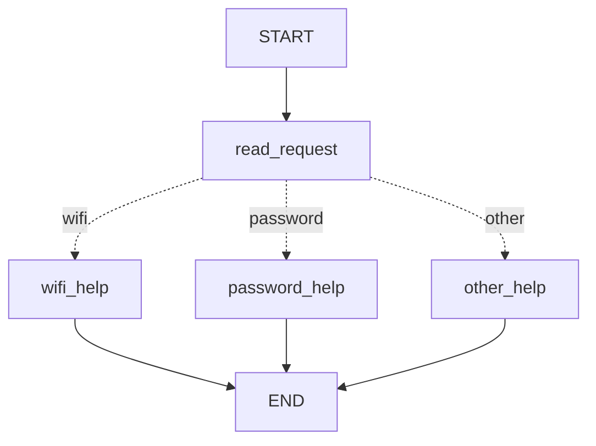
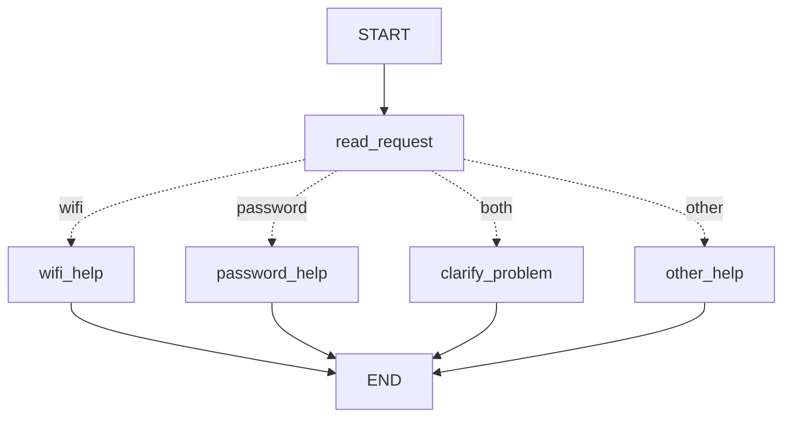
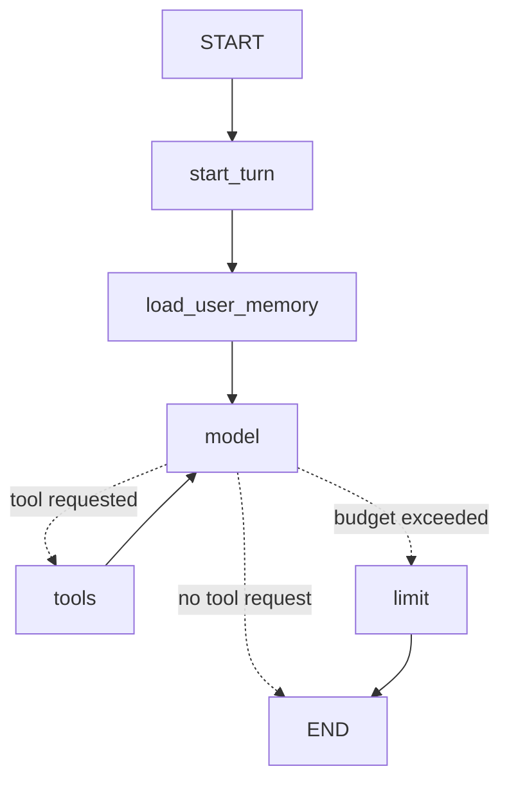

# HW5 - My LangGraph helpdesk

Everything below refers to my own saved runs in `outputs/`. Real-model runs: **OpenAI
`gpt-4o-mini`**, temperature 0, Python 3.12.2, LangGraph 1.2.22. Commands and setup are in
[README.md](README.md).

## Part 1 - How the graph works

### My graph and state



(Generated by LangGraph: `outputs/graph_part1_original.mmd`. Dotted lines are the conditional edge.)

State (`HelpdeskState` in `helpdesk/part1.py`): `message` (original text, never changed),
`category` (set by `read_request`), `reply` (set by a help node).

1. **What does each node read and change?** `read_request` reads `message` and writes
   `category`. `wifi_help`, `password_help`, `other_help` do not need the message: they write
   `reply` (the first two take the text from `data/helpdesk.json`, `other_help` writes a fixed
   question). They are only reached because of the value of `category`.
2. **Node update vs conditional edge.** A node returns a dictionary with the fields it changes
   and LangGraph merges it into the state. A conditional edge (`route_after_read`) is a function
   that reads the state and returns only the *name of the next node*. It changes no state.
3. **What does the next node receive?** The whole current state (message + category + anything
   already set), not just the previous node's update; LangGraph has merged the update first.
4. **START, END, compile.** `START` is the entry point (it points at `read_request`). `END` is
   the terminal marker; a run stops when it reaches it. `compile()` checks the graph (every node
   connected, edge targets exist) and returns a runnable object; this is where a checkpointer or
   store is attached in Parts 2-3.

### Predictions before running

Predicted by applying the stated rules by hand; "actual" is taken from `outputs/S01.json` -
`S04.json`.

| Message | Predicted route | Actual route | What I learned |
| --- | --- | --- | --- |
| I cannot connect to Wi-Fi. | read_request -> wifi_help | read_request -> wifi_help (S01) | `Wi-Fi` is matched through the alias `wi-fi`. |
| I forgot my PASSWORD. | read_request -> password_help | read_request -> password_help (S02) | Matching is case-insensitive because the message is lower-cased first. |
| My laptop screen is broken. | read_request -> other_help | read_request -> other_help (S03) | Anything outside the two topics asks the user which topic they mean. |
| My Wi-Fi password does not work. | read_request -> wifi_help (Wi-Fi is checked first) | read_request -> wifi_help (S04) | The user may mean the password, but the rule order decides: the reply is Wi-Fi instructions. |

**Both topics.** "My Wi-Fi password does not work." contains `wi-fi` and `password`. The original
rule says: if the message contains `wifi`/`wi-fi` go to `wifi_help`; *otherwise* check
`password`. Rule order makes Wi-Fi win, so the user gets Wi-Fi instructions and the password
topic is silently ignored.

### My change to the graph

`categorize_clarified` now returns `both` when both topics are found, and the router sends
`both` to a new node `clarify_problem`.



New trace (`outputs/S05.json`): `START -> read_request -> clarify_problem -> END`;
state after `read_request`: `category = "both"`; after `clarify_problem`: `reply = "Is the problem
connecting to Wi-Fi, or recovering your account password?"`. The difference from S04 is a
different *route* (a different node ran), not only a different sentence from the same node.
Single-topic and unsupported messages still take their old routes (`tests/test_routing.py`).

**What LangGraph controls:** running `read_request` first, merging each node's returned update
into the state, calling the routing function and following the node name it returns, stopping at
`END`, and producing the node-by-node trace. **What my Python functions decide:** which words
count as a topic (`detect_topics`), which category a message gets (`categorize_original` /
`categorize_clarified`), which branch name the category maps to (`route_after_read`), and what
each help node says. No model makes any decision in Part 1.

## Part 2 - Model and tools

Model and provider: **OpenAI, `gpt-4o-mini`** (via `langchain-openai`), temperature 0.



Loop: the model **requests** a tool -> `tools` (my code) validates and **runs** it -> the
`ToolMessage` result is appended to `messages` -> the model runs again and either requests
another tool or answers.

**Loop limit.** Per user message: at most `MAX_MODEL_CALLS = 8` model calls and
`MAX_TOOL_CALLS = 6` tool executions (`helpdesk/agent.py`). It is enforced in the routing function
`after_model`, in my code, not by trusting the model: if the next tool request would exceed the
budget it routes to the `limit` node, which answers every pending request with a
`loop_limit_reached` error and ends with a clear message. `start_turn` resets the counters for
each new user message. `tests/test_agent.py` uses a model that never stops asking and checks that
it is stopped and that the budget resets.

**Tools called directly (no agent, no model)** - `tests/test_tools.py` does this for each tool,
for example:

```python
from helpdesk.tools import find_instructions, check_service_status, prepare_ticket
find_instructions("wifi")                       # GUIDE-WIFI with 4 steps
check_service_status("wifi", "wifi_outage")     # status: outage
prepare_ticket("wifi", "Cannot connect", ["Enabled Wi-Fi"], "operational",
               user_id="demo-user-a", thread_id="t1", status_profile="normal")  # writes a local draft
```

**One request that needs several tools (S06, `outputs/S06.json`, snapshot `normal`).** Message 1
"Show me the Wi-Fi troubleshooting steps." -> `find_instructions`. Message 2 "I enabled Wi-Fi and
forgot the saved network ... Check whether Wi-Fi is down. If it is operating, prepare a ticket"
-> model requested `check_service_status(wifi)` -> result `operational` -> model requested
`prepare_ticket` -> draft `outputs/tickets/TKT-20261116-144359-a2e4.json` with
`steps_tried = ["I enabled Wi-Fi and forgot the saved network."]`, `service_status = operational`,
`status_profile = normal`. The final answer says that nothing has been sent.

**The same request with different snapshots**

| Snapshot | Log | Tools that ran | Outcome |
| --- | --- | --- | --- |
| `normal` (S06) | `S06.json` | check_service_status, prepare_ticket | status operational, ticket draft written |
| `wifi_outage` (S07) | `S07.json` | check_service_status | outage reported, **no ticket**, "no repair time available" |
| `status_unavailable` (S08) | `S08.json` | check_service_status (prepare_ticket request refused by my code) | "could not determine the status, cannot confirm it is operating"; offers a draft that says so; **no ticket** |

**Questions**

1. **How does the graph decide between running a tool and ending?** `after_model` looks at the
   last model message. If it has tool requests (and the budget allows) it goes to `tools`; if the
   budget is exceeded it goes to `limit`; if there are no tool requests it goes to `END`.
2. **Which component requests a tool, and which runs it?** The model requests (it only produces
   a name and arguments). The `tools` node, i.e. my `execute_tool`, validates the arguments with
   a pydantic schema and executes the Python function. The model never executes anything and
   cannot choose `user_id`, `thread_id` or the status snapshot - they come from the config set by
   my application.
3. **What changes in the state after a tool result?** One `ToolMessage` per request is appended to
   `messages` (reducer `add_messages`), carrying the request id and the JSON result, and the
   `tool_calls` counter increases. Then control returns to `model`, which now sees the result.
4. **What is different from Part 1?** Part 1 followed fixed keyword rules and always took exactly
   one path. In Part 2 the model decides which tools to call, in which order and how many times,
   based on the user's wording and on earlier tool results; the number of steps varies (S06: one
   tool in turn 1, two in turn 2). My code only limits and checks what the model asks for.

**What went wrong first, and what I changed (honest log).**

* S08, first real run (`outputs/S08_before_fix.json`): the model created a ticket although the
  status was `unknown` and the user wanted a ticket only if Wi-Fi was operating. I added a flag
  `only_if_operating`, but the model did not set it in the next run. Final fix: `prepare_ticket`
  re-reads the real status from the snapshot and reads the user's condition from the user's own
  message (`ticket_is_conditional`), so the rule no longer depends on the model obeying the
  prompt. Final S08 run: the request is refused with `condition_not_met` and the model offers a
  draft stating the status could not be checked.
* S06 (first run): the model added "airplane mode is off" to `steps_tried`; the user had not said
  that. I tightened the prompt; the final ticket contains only the user's words.
* S10/S11: the model prepared a ticket nobody asked for. Added a code rule: `prepare_ticket` is
  refused (`ticket_not_requested`) unless the user mentioned a ticket or draft in the conversation.
* S09: in one run the model asked whether the ticket should be conditional instead of preparing
  it. I changed the prompt; the next run prepared the draft (`TKT-20261116-144640-c38b`).

## Part 3 - Memory

Two separate kinds of memory, both SQLite files in `local-storage/` (ignored by git):

| | Conversation memory | User memory |
| --- | --- | --- |
| Holds | messages, current problem, steps already tried | reply-language preference |
| LangGraph component | SQLite checkpointer (`checkpoints.sqlite`) | SQLite store (`user_memory.sqlite`), namespace `("preferences", user_id)` |
| Key | `thread_id` | `user_id` |
| Written by | the graph automatically after every step | tool `remember_language_preference`, only when the user explicitly asks to remember |
| Read by | the checkpointer when a thread continues | node `load_user_memory` at the start of every turn |

**`thread_id` vs user identifier.** A `thread_id` identifies one *conversation* - its message
history and state. A user id identifies a *person*, who can have many threads. Conversation state
is per thread; the saved preference is per user and is shared by all of that user's threads. Both
ids are supplied by my application (`make_config`); the model cannot choose them, so it cannot
read or write someone else's memory (tested).

| Situation | Command used | Log file | What happened |
| --- | --- | --- | --- |
| Refer to an earlier message | `python -m helpdesk.run_scenarios S10` | `outputs/S10.json` | Turn 2 "Which steps did I already try?" answered from the thread's messages: enabled Wi-Fi, forgot the saved network, reconnecting failed. `user_memory_read = {}`. |
| Close, restart and resume | `python -m helpdesk.run_scenarios S11` | `outputs/S11.json` | Two different processes (pids 10864 and 29832). After the restart, the same user and thread recalled the Wi-Fi problem and the steps (in Kazakh) with no transcript pasted in. |
| Same user, new conversation | `python -m helpdesk.run_scenarios S12` | `outputs/S12.json` | Thread `preference-a1` saved the preference; after a restart (pids 11124, 27904) thread `preference-a2` read `user_memory_read = {"language": "Kazakh"}` and answered in Kazakh. It did not know the problem from the first thread. |
| Different user | `python -m helpdesk.run_scenarios S13` | `outputs/S13.json` | `demo-user-b` read `user_memory_read = {}`; the answer: "No preference or previous problem has been recorded." |

**Retrieval vs memory.** Looking up Wi-Fi instructions (`find_instructions`) is *retrieval*: it
reads a fixed shared reference file, `data/helpdesk.json`, that is the same for every user and
does not change because of the conversation. Recalling that this user chose Kazakh is *memory*:
information learned from this user in an earlier conversation, written by the application and
available only to that user. In the logs these are different sources: `reference_file`
vs `user_memory` / `conversation_state`.

## Part 4 - Running and checking my work

* Setup, versions, memory location/reset, commands: [README.md](README.md). Exact package
  versions: [requirements.txt](requirements.txt) (Python 3.12.2).
* Tests: `python -m pytest -q` - 53 tests; the README table explains what each file would catch.
* CI: `.github/workflows/tests.yml` runs the tests on every push with no API key.
* **Fake model:** `helpdesk/fake_model.py` (`FakeRuleModel`, labelled "NOT an LLM") is used by
  the tests and by CI only. All logs in `outputs/S01-S14.json` are from the real model
  (Part 1 uses no model at all). Part 2/3 logs show `provider: openai`.
* The real-model runs are separate from CI and were made by hand.

## Choices and limitations

* **Storage:** SQLite for both memories. It is local, needs no server, survives a restart, and
  the SQLite checkpointer is a supplied dependency. The user store uses LangGraph's SQLite store
  so the same code reads user memory in every thread.
* **Model:** `gpt-4o-mini` through `langchain-openai`: cheap and supports tool calls.
* **Safety in code, not only in the prompt:** the real model broke prompt rules in my runs
  (S06, S08, S10, S11, S09), so ticket rules are enforced by code: required details, no secrets,
  a ticket only if the user asked, a conditional ticket only if the real status allows it, and
  the status recorded in the ticket comes from the snapshot, not from the model's claim.
* **Limitations:**
  * `ticket_was_requested` / `ticket_is_conditional` are English keyword heuristics ("ticket", "draft",
    "if it is operating"); a request phrased differently or in another language could be missed.
  * The code cannot verify that `steps_tried` contains only what the user said; that depends on the
    prompt and the model (the S06 ticket was correct, the first run was not).
  * Model output is not deterministic; S09 once behaved differently between runs.
  * Part 1 matches keywords as substrings, so a word that merely contains `wifi` would match.
  * Only one kind of user preference (reply language) is stored, and it can only be cleared by
    resetting the storage.
  * The service status comes from the snapshot chosen by the runner, not from a real service.
  * Kazakh text can display incorrectly in some Windows consoles; the saved logs use UTF-8.

## Supplied scenarios - my actual results

All commands run from the repo root with the virtual environment active. Logs are in `outputs/`.

| Scenario | Command or manual steps | Log file | What happened / what I changed |
| --- | --- | --- | --- |
| S01 - Simple Wi-Fi route | `python -m helpdesk.part1_cli --scenario S01` | `outputs/S01.json` | read_request -> wifi_help; Wi-Fi guide returned. Matched prediction. |
| S02 - Case-insensitive password route | `python -m helpdesk.part1_cli --scenario S02` | `outputs/S02.json` | "PASSWORD" -> password_help; matching is case-insensitive. |
| S03 - Unsupported request | `python -m helpdesk.part1_cli --scenario S03` | `outputs/S03.json` | read_request -> other_help; asks Wi-Fi or password. |
| S04 - Two topics before the graph change | `python -m helpdesk.part1_cli --scenario S04` | `outputs/S04.json` | Original graph: wifi_help, because Wi-Fi is checked first; password topic ignored. Motivated the change. |
| S05 - Two topics after adding clarification | `python -m helpdesk.part1_cli --scenario S05` | `outputs/S05.json` | Changed graph: read_request -> clarify_problem (category `both`); asks which problem first. Original vs changed graph drawn above. |
| S06 - Instructions then local ticket | `python -m helpdesk.run_scenarios S06` | `outputs/S06.json` | Turn 1: find_instructions. Turn 2: check_service_status (operational) then prepare_ticket -> `outputs/tickets/TKT-20261116-144359-a2e4.json`, only the user's steps. First run added an invented step; prompt tightened. |
| S07 - The same request during a Wi-Fi outage | `python -m helpdesk.run_scenarios S07` | `outputs/S07.json` | check_service_status -> outage; no ticket; no repair time invented. |
| S08 - Status source unavailable | `python -m helpdesk.run_scenarios S08` | `outputs/S08.json` (before fix: `S08_before_fix.json`) | Before: ticket wrongly created at `unknown`. Now `prepare_ticket` refused (`condition_not_met`); model says status unknown and offers a draft that states it. |
| S09 - Missing ticket details | `python -m helpdesk.run_scenarios S09` | `outputs/S09.json` | Turn 1: asks for the problem and steps, no tools. Turn 2: prepare_ticket -> `TKT-20261116-144640-c38b` with the user's details. An earlier run asked a confusing question instead; prompt changed. |
| S10 - Use the current conversation | `python -m helpdesk.run_scenarios S10` | `outputs/S10.json` | Turn 2 listed the steps from the same thread's history. Earlier run created an unrequested ticket; added the `ticket_not_requested` rule. |
| S11 - Persist and recall after restart | `python -m helpdesk.run_scenarios S11` | `outputs/S11.json` | Preference saved by the tool; real restart (pids 10864 -> 29832); same thread recalled problem and steps in Kazakh. |
| S12 - Preference across threads without replay | `python -m helpdesk.run_scenarios S12` | `outputs/S12.json` | New thread after a restart read `language = Kazakh` from user memory and replied in Kazakh without the old transcript. |
| S13 - Do not share memory between users | `python -m helpdesk.run_scenarios S13` | `outputs/S13.json` | demo-user-b read empty memory; answered that nothing has been recorded. |
| S14 - Password recovery outage | `python -m helpdesk.run_scenarios S14` | `outputs/S14.json` | Checked `account_recovery` (not Wi-Fi): outage, no repair time invented. |
